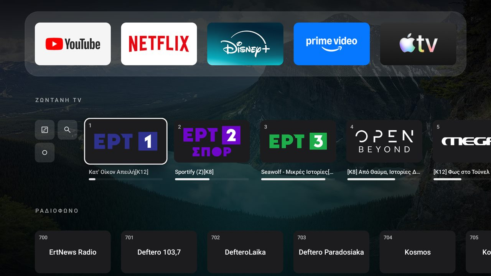
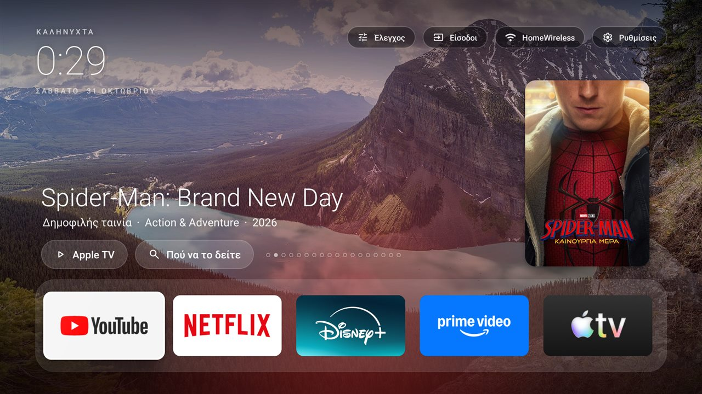
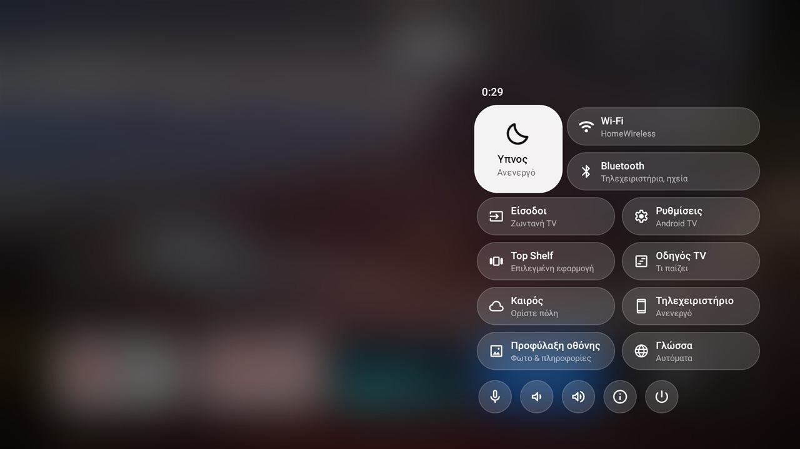
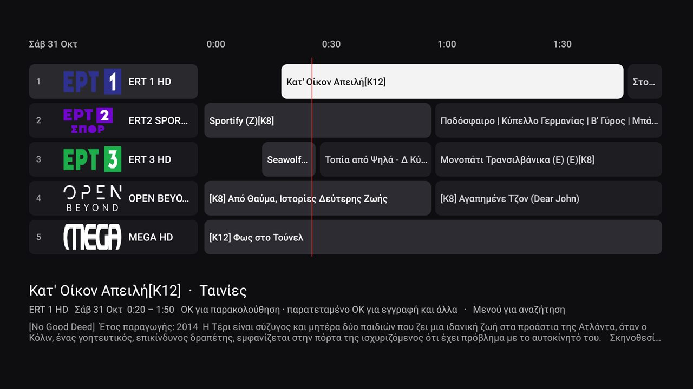

# tv-home · Έκδοση Live TV

**Μια γρήγορη, καθαρή αρχική οθόνη τύπου Apple TV για Android TV, με ζωντανή τηλεόραση από τον δικό σου
διακομιστή [Tvheadend](https://tvheadend.org) ενσωματωμένη:** κανάλια στην αρχική οθόνη, οδηγός
προγράμματος, εγγραφές, ραδιόφωνο με ζωντανό φασματικό διάγραμμα και παύση της ζωντανής τηλεόρασης. Μία
μικρή εφαρμογή, χωρίς διαφημίσεις, χωρίς ξεχωριστή εφαρμογή τηλεόρασης.



*Also in English: [README.md](README.md).*

## Βασικά σημεία

- **Στα Ελληνικά και στα Αγγλικά.** Όλη η εφαρμογή, η σελίδα του τηλεχειριστηρίου κινητού και η
  προφύλαξη οθόνης ακολουθούν τη γλώσσα της τηλεόρασης, ενώ το *Κέντρο ελέγχου → Γλώσσα* επιλέγει
  ανάμεσα σε Αυτόματα, English και Ελληνικά.
- **Ζωντανή τηλεόραση εκεί που είναι οι εφαρμογές σου.** Κανάλια με λογότυπα και γραμμή προόδου «τι
  παίζει τώρα» μέσα στην αρχική οθόνη, με αναπαραγωγή από τους hardware αποκωδικοποιητές της συσκευής.
  Tvheadend, δικτυακοί δέκτες τύπου HDHomeRun και εφαρμογές δεκτών στη συσκευή τροφοδοτούν τις ίδιες σειρές.
- **Ένα πλήρες σύνολο εργαλείων τηλεόρασης σε μία μικρή εφαρμογή:** οδηγός προγράμματος, εγγραφές,
  εγγραφή όλων των επεισοδίων, αναζήτηση, υπενθυμίσεις, παύση ζωντανής τηλεόρασης και ραδιόφωνο με
  ζωντανό φασματικό διάγραμμα.
- **Μια προφύλαξη οθόνης που αξίζει να βλέπεις.** Οι φωτογραφίες σου κινούνται αργά κάτω από ένα
  ρολόι, με μια γραμμή ειδήσεων κάτω και, με τη σειρά, ο καιρός, τι παίζει τώρα στην τηλεόραση, δημοφιλείς
  ταινίες και οι επικεφαλίδες της ημέρας. [Δες την παρακάτω.](#προφύλαξη-οθόνης)
- **Φινίρισμα Apple TV:** Top Shelf με ό,τι έβλεπες, προτάσεις και ειδήσεις, Κέντρο ελέγχου από
  παγωμένο γυαλί, θολωμένα μενού και μια γραμμή «τελευταία προβολή» κάτω από κάθε εφαρμογή.
- **Τηλεχειριστήριο στο κινητό χωρίς εφαρμογή για εγκατάσταση.** Σάρωσε έναν κωδικό QR και το κινητό
  σου αλλάζει κανάλι, κάνει παύση, ψάχνει στον οδηγό, προγραμματίζει εγγραφές και στέλνει φωτογραφίες
  στην τηλεόραση ως ταπετσαρίες.
- **Ελαφρύ επίτηδες.** Περίπου 5,7 MB, απλές προβολές Android, τίποτα στο παρασκήνιο· φτιαγμένο για
  συσκευή με 2 GB μνήμης. [Πώς μένει ελαφρύ](#πώς-μένει-ελαφρύ).
- **Σύγχρονα εργαλεία.** Gradle 9.8, Android Gradle Plugin 9.5, Media3 1.11, με unit tests και lint
  σε κάθε push μέσω CI.

## Τι κάνει

**Αρχική οθόνη**
- Μια γραμμή με τις αγαπημένες σου εφαρμογές κάτω από το ρολόι, πάνω σε εναλλασσόμενες ταπετσαρίες
  φύσης, με λάμψη στο χρώμα της επιλεγμένης εφαρμογής. Όλες οι υπόλοιπες εφαρμογές σε πλέγμα από κάτω.
- Απλές προβολές Android, τίποτα στο παρασκήνιο. Ολόκληρο το APK είναι περίπου 5,7 MB, κυρίως
  ταπετσαρίες.

**Live TV**
- Μια σειρά **LIVE TV** με όλα τα κανάλια (ο Οδηγός, η Αναζήτηση, οι Εγγραφές και η Συνέχεια είναι σε ένα
  μικρό μπλοκ στην αρχή της: πάτα Αριστερά): λογότυπο, αριθμός, τι παίζει τώρα και γραμμή προόδου. Διάλεξε
  ένα και παίζει σε πλήρη οθόνη με τους **hardware αποκωδικοποιητές** της συσκευής (MPEG-2, H.264, HEVC,
  MP2, AAC, AC3).
- **Τρία είδη πηγών**, μόνες ή μαζί, συγχωνευμένες στις ίδιες σειρές:
  - ένας διακομιστής **Tvheadend** (όλα τα παρακάτω: οδηγός, εγγραφές, σειρές, αναζήτηση, υπενθυμίσεις)·
  - ένας **δικτυακός δέκτης** (HDHomeRun και συμβατοί), που βρίσκεται στο δίκτυο («auto») ή με διεύθυνση·
    τα κανάλια του παίζουν στον ίδιο player, με παύση, μίνι οδηγό και πληροφορίες ροής·
  - **εφαρμογές δεκτών στη ίδια τη συσκευή** (π.χ. η εφαρμογή ενός USB δέκτη που δημοσιεύει κανάλια
    Android TV), που παίζουν μέσω της προβολής τηλεόρασης του Android.

  Ένα κανάλι που έχει ήδη το Tvheadend μένει αυτό του Tvheadend. Καμία πηγή; Η σειρά προτείνει ρύθμιση,
  ή κράτα πατημένο το OK πάνω της για να κρύψεις εντελώς τη Live TV.
- **Οδηγός**: πλέγμα προγράμματος σε πλήρη οθόνη με λογότυπα καναλιών, γραμμή «τώρα» και την περιγραφή
  της επιλεγμένης εκπομπής. Το OK βλέπει ό,τι παίζει ή καταγράφει ό,τι έρχεται.
- **Εγγραφές**: τι καταγράφεται, τι είναι προγραμματισμένο, τι έχει καταγραφεί ή απέτυχε. Αναπαραγωγή με
  μετακίνηση, ακύρωση, διαγραφή. Εγγραφή από τον οδηγό ή από τον player.
- **Ραδιόφωνο**: οι σταθμοί έχουν δική τους σειρά και μια ήρεμη οθόνη αναπαραγωγής με **ζωντανό
  φασματικό διάγραμμα**.
- **Μίνι οδηγός ενώ βλέπεις**: το OK δείχνει όλα τα κανάλια με λογότυπο, τι παίζει (και πόσο απομένει) και
  τι ακολουθεί, πάνω από την εικόνα.
- **Εγγραφή σειράς**: «Εγγραφή όλων των επεισοδίων» από τον οδηγό, την αναζήτηση ή τον player· διαχείριση
  των σειρών στις Εγγραφές.
- **Αναζήτηση**: βρες μια εκπομπή με τίτλο σε ολόκληρο τον οδηγό και μετά δες την, κατέγραψέ την ή βάλε
  υπενθύμιση.
- **Υπενθυμίσεις**: αναδυόμενο παράθυρο ένα λεπτό πριν ξεκινήσει μια εκπομπή, με Παρακολούθηση / Παράβλεψη,
  ακόμη και πάνω από άλλες εφαρμογές.
- **Συνέχεια προβολής**: οι εγγραφές συνεχίζονται από εκεί που σταμάτησες και η τελευταία παίρνει κάρτα
  στην αρχική σειρά.
- **Χρονοδιακόπτης ύπνου**: από 15 λεπτά έως 2 ώρες ή μέχρι το τέλος της εκπομπής· προειδοποίηση ενός λεπτού
  και μετά αναμονή.
- **Πληροφορίες ροής**: κωδικοποιητής, ανάλυση, ρυθμός bit, καθώς και σήμα, SNR και μετρητές σφαλμάτων του δέκτη.
- **Παύση ζωντανής τηλεόρασης**, και μετά συνέχεια από εκεί που σταμάτησες ή επιστροφή στο ζωντανό.
- **Κομμάτια ήχου και υποτίτλων**, με τη γλώσσα να θυμάται από κανάλι σε κανάλι.
- **Αγαπημένα**: κράτα πατημένο το OK σε ένα κανάλι για να το καρφιτσώσεις· η σειρά δείχνει τότε μόνο τα
  αγαπημένα σου, με τη δική σου σειρά.
- Μια **κόκκινη κουκκίδα** στα κανάλια που καταγράφονται αυτή τη στιγμή, και προειδοποίηση δίπλα στο LIVE TV
  όταν ο δίσκος εγγραφών του διακομιστή γεμίζει.
- **Προφύλαξη οθόνης**: φωτογραφίες, ρολόι, καιρός, γραμμή ειδήσεων, τι παίζει τώρα και δημοφιλείς ταινίες
  όσο η τηλεόραση μένει αδρανής· κάθε μέρος μπορεί να κλείσει. Δες [Προφύλαξη οθόνης](#προφύλαξη-οθόνης).
- **Προφύλαξη οθόνης ραδιοφώνου**: μετά από τρία λεπτά αδράνειας η οθόνη του ραδιοφώνου σκουραίνει και
  κινείται αργά. Όταν ανοίγεις εκεί τη λίστα καναλιών, ο σταθμός που παίζει μένει στο κέντρο.
- **Καιρός** κάτω από το ρολόι (Open-Meteo, χωρίς λογαριασμό), και **Κατάσταση συσκευής**: ελεύθερη μνήμη
  και χώρος, χρόνος λειτουργίας, ο δίσκος εγγραφών· η εφαρμογή καθαρίζει την προσωρινή μνήμη της μία φορά
  την ημέρα.
- **Τελευταία προβολή, κάτω από κάθε εφαρμογή της γραμμής**: επίλεξε μια εφαρμογή και το όνομά της παίρνει
  ό,τι είδες τελευταία εκεί («▶ τίτλος · εκπομπή · απομένουν 12 λεπτά», με γραμμή προόδου και το εξώφυλλο
  να φαίνεται αχνά πίσω), ή «Σε παύση στο 14:49», ή «Άνοιξε τελευταία φορά πριν από 20 λεπτά» για εφαρμογές
  που δεν λένε τι παίζουν. Μόνο ό,τι παίχτηκε σε αυτή τη συσκευή, αποθηκευμένο σε αυτήν.
- **Top Shelf** (Έλεγχος → Top shelf), η μεγάλη περιοχή πάνω από τη γραμμή εφαρμογών, σε μία από
  τέσσερις λειτουργίες: *Επιλεγμένη εφαρμογή* (ό,τι είδες τελευταία εκεί, η προεπιλογή), *Συνέχεια προβολής: όλα*
  (καρουζέλ με Συνέχιση / Κατάργηση), *Προτάσεις & ειδήσεις* (οι δημοφιλείς ταινίες της Ελλάδας από τη λίστα
  της Apple, με Apple TV και Πού να δεις· επικεφαλίδες με φωτογραφίες από ERT News, Kathimerini ή in.gr, με
  QR για να τις διαβάσεις στο κινητό), ή *Ανενεργό*. Οι ταινίες και οι ειδήσεις κλείνουν ξεχωριστά.
- **Τηλεχειριστήριο κινητού**: Έλεγχος → Τηλεχειριστήριο κινητού δείχνει έναν κωδικό QR· σάρωσέ τον και το
  τηλεχειριστήριο ανοίγει ήδη συνδεδεμένο (μόνο στο οικιακό δίκτυο). Από το κινητό: αλλαγή καναλιού, παύση,
  επιστροφή στο ζωντανό, ένταση, χρονοδιακόπτης ύπνου, σβήσιμο και άναμμα της τηλεόρασης, η λίστα καναλιών,
  ο οδηγός (τώρα και επόμενο σε κάθε κανάλι, ή αναζήτηση) με εγγραφή / όλα τα επεισόδια / υπενθύμιση,
  άνοιγμα εφαρμογών και αποστολή φωτογραφιών ως ταπετσαρίες. Το Android δεν επιτρέπει να πατάει πλήκτρα
  μέσα σε άλλες εφαρμογές.
- **Φωνητική αναζήτηση**: το μικρόφωνο στην Αναζήτηση χρησιμοποιεί τη φωνητική εισαγωγή του Google TV
  μέσω του τηλεχειριστηρίου.
- **Η γραμμή εφαρμογών σου**: κράτα πατημένο το OK σε οποιαδήποτε εφαρμογή για Άνοιγμα, Προσθήκη στη γραμμή /
  Μετακίνηση αριστερά / Μετακίνηση δεξιά / Κατάργηση από τη γραμμή, Απόκρυψη, Πληροφορίες εφαρμογής και
  Απεγκατάσταση. Έως 6 εφαρμογές· η επιλογή σου αντικαθιστά την προεπιλεγμένη λίστα.
- **Κέντρο ελέγχου** (Έλεγχος, πάνω δεξιά), στυλ tvOS: κάψουλες από παγωμένο γυαλί πάνω από θολωμένη οθόνη.
  Χρονοδιακόπτης ύπνου για όλη τη συσκευή, Wi-Fi, Bluetooth (η οθόνη σύζευξης αξεσουάρ του Android TV),
  Είσοδοι, Ρυθμίσεις, Top shelf, Οδηγός προγράμματος, λεπτομέρειες καιρού (αίσθηση θερμοκρασίας, επόμενες
  ώρες, 3 ημέρες, ανατολή/δύση, UV, βροχή, ποιότητα αέρα), τηλεχειριστήριο κινητού, επιλογές προφύλαξης
  οθόνης, Γλώσσα, και στρογγυλά κουμπιά για φωνητική αναζήτηση, ένταση, Κατάσταση συσκευής και
  Απενεργοποίηση.
- **Ελληνικά και Αγγλικά.** Η εφαρμογή ακολουθεί τη γλώσσα της τηλεόρασης (Ρυθμίσεις → Σύστημα → Γλώσσα).
  Για να επιβάλεις μία, χρησιμοποίησε το *Κέντρο ελέγχου → Γλώσσα*: Αυτόματα, English ή Ελληνικά (η εφαρμογή
  επανεκκινείται για να εφαρμοστεί). Η σελίδα του τηλεχειριστηρίου κινητού ακολουθεί τη γλώσσα του κινητού,
  και οι ημερομηνίες και οι ημέρες της εβδομάδας ακολουθούν τη γλώσσα που επέλεξες.
- **Παγωμένο γυαλί** πίσω από κάθε μενού και διάλογο (ένα εφάπαξ θολωμένο στιγμιότυπο, άρα δεν κοστίζει
  τίποτα όσο η συσκευή είναι αδρανής) και καθαρά εικονίδια με γραμμές παντού (Material Symbols Rounded).
- **Ταπετσαρίες από το κινητό σου**: στο τηλεχειριστήριο κινητού, *Αποστολή φωτογραφίας*· αλλάζει μέγεθος
  στο κινητό και εμφανίζεται αμέσως στην τηλεόραση. Συνδύασέ τες με τις ενσωματωμένες φωτογραφίες ή δείξε
  μόνο τις δικές σου.
- **Απόκρυψη εφαρμογών** από το πλέγμα (κράτα πατημένο το OK → Απόκρυψη από όλες τις εφαρμογές).
- Προαιρετικά: έναρξη του τελευταίου καναλιού όταν ανοίγει η συσκευή.

<table>
<tr>
<td></td>
<td></td>
</tr>
<tr>
<td></td>
<td></td>
</tr>
<tr>
<td></td>
<td></td>
</tr>
<tr>
<td></td>
<td></td>
</tr>
</table>

<sub>Η εικόνα του βίντεο λείπει από τα στιγμιότυπα επίτηδες: η συσκευή ζωγραφίζει το βίντεο που
αποκωδικοποιείται με hardware σε δικό του επίπεδο, που τα στιγμιότυπα δεν καταγράφουν.</sub>

## Προφύλαξη οθόνης

Όταν η τηλεόραση μένει αδρανής (μετά από 10 λεπτά, το συνηθισμένο χρονικό όριο του Android) γίνεται κορνίζα:

- **Φωτογραφίες, αργά.** Οι ενσωματωμένες ταπετσαρίες και όσες φωτογραφίες έστειλες από το κινητό σου
  εναλλάσσονται με ήπιο ζουμ, κάτω από ένα λεπτό ρολόι και την ημερομηνία. Ο καιρός είναι στη γωνία.
- **Μια γραμμή ειδήσεων** κυλά τις τελευταίες επικεφαλίδες στο κάτω μέρος.
- **Ενδιάμεσα, μερικές διαφάνειες**: ο **καιρός** (τώρα, αίσθηση θερμοκρασίας, τρεις ημέρες), **τι παίζει τώρα
  στην τηλεόραση** στα αγαπημένα σου κανάλια με το τι ακολουθεί, **δημοφιλείς ταινίες** με τις αφίσες τους, και
  **επικεφαλίδες** με τη φωτογραφία της είδησης.
- **Τίποτα καινούργιο να ρυθμίσεις.** Χρησιμοποιεί ό,τι έχει ήδη η εφαρμογή: την πόλη του καιρού, τον οδηγό
  και τα αγαπημένα σου από το Tvheadend, την πηγή ειδήσεων του Top Shelf (ERT News, Kathimerini ή in.gr),
  τις ταπετσαρίες. Οι διαφάνειες για πράγματα που δεν έχεις ρυθμίσει (χωρίς Tvheadend, χωρίς καιρό)
  απλώς δεν εμφανίζονται.
- **Εσύ επιλέγεις τι φαίνεται.** Το *Έλεγχος → Προφύλαξη οθόνης* έχει **Έναρξη τώρα**, διακόπτη για καθεμία
  από τις διαφάνειες Καιρός, Τώρα στην τηλεόραση, Δημοφιλείς ταινίες, Ειδήσεις και για τη γραμμή ειδήσεων,
  και πόση ώρα μένει κάθε διαφάνεια (8, 16 ή 30 δευτερόλεπτα).

<table>
<tr>
<td></td>
<td></td>
</tr>
<tr>
<td></td>
<td></td>
</tr>
<tr>
<td colspan="2"></td>
</tr>
</table>

Επίλεξέ την μία φορά, μέσω ADB (λειτουργεί και από τις Ρυθμίσεις του Google TV → Προτιμήσεις συσκευής → Προφύλαξη οθόνης):

```bash
adb shell settings put secure screensaver_components io.github.ksfikas.tvhome/.Screensaver
adb shell settings put secure screensaver_enabled 1
```

Για να τη δεις αμέσως χωρίς αναμονή: *Έλεγχος → Προφύλαξη οθόνης → Έναρξη τώρα*, ή
`adb shell am start -a com.google.android.pano.action.SLEEP` (η δική του ενέργεια «ύπνου» του Google TV,
που ξεκινά την επιλεγμένη προφύλαξη οθόνης). Οποιοδήποτε πλήκτρο του τηλεχειριστηρίου την ξυπνά.

## Τηλεχειριστήριο

| Πού | Κουμπί | Κάνει |
|---|---|---|
| Αρχική | OK σε κανάλι | Το βλέπει |
| | Παρατεταμένο OK σε κανάλι | Αγαπημένα (προσθήκη, αφαίρεση, αναδιάταξη), ρύθμιση Live TV |
| | Παρατεταμένο OK σε εφαρμογή του πλέγματος | Την κρύβει (επαναφορά: *Είσοδοι → Εμφάνιση κρυμμένων εφαρμογών*) |
| Βλέποντας TV | Πάνω / Κάτω, Κανάλι ± | Επόμενο / προηγούμενο κανάλι |
| | Αριστερά | Πίσω στο προηγούμενο κανάλι |
| | Δεξιά, Info | Banner τώρα/επόμενο |
| | OK | Μίνι οδηγός (τώρα και επόμενο σε κάθε κανάλι) |
| | Παρατεταμένο OK, Menu | Επιλογές: παύση, πίσω στο ζωντανό, ήχος, υπότιτλοι, εγγραφή, όλα τα επεισόδια, οδηγός, εγγραφές, χρονοδιακόπτης ύπνου, πληροφορίες ροής |
| | Play/Pause | Παύση ή συνέχιση ζωντανής τηλεόρασης |
| | 0–9 | Αλλαγή καναλιού με αριθμό |
| Οδηγός | Βέλη | Μετακίνηση· περισσότερο πρόγραμμα φορτώνει καθώς πας δεξιά |
| | OK | Παρακολούθηση (ό,τι παίζει), ή εγγραφή / όλα τα επεισόδια / υπενθύμιση (αργότερα) |
| | Παρατεταμένο OK | Το ίδιο μενού για οποιαδήποτε εκπομπή |
| | Menu | Αναζήτηση |
| Αναζήτηση | Πληκτρολόγηση, μετά Κάτω | Αποτελέσματα· OK για παρακολούθηση / εγγραφή / όλα τα επεισόδια / υπενθύμιση |
| Εγγραφές | OK, παρατεταμένο OK | Αναπαραγωγή (ή ακύρωση αν είναι προγραμματισμένη), διαγραφή· το OK σε σειρά ή υπενθύμιση τη σταματά |
| Αναπαραγωγή εγγραφής | Αριστερά / Δεξιά, Πάνω / Κάτω | Πίσω / μπροστά 30 δευτ., 5 λεπτά |
| | OK | Παύση |

## Εγκατάσταση

### Πριν ξεκινήσεις

- **Μια τηλεόραση ή συσκευή με Android 11 ή νεότερο.** Φτιάχτηκε και δοκιμάστηκε σε Google TV (Android 14).
  Τα βήματα παρακάτω απενεργοποιούν την αρχική οθόνη του Google TV· άλλα μοντέλα Android TV έχουν
  διαφορετικά ονόματα πακέτων για τη δική τους (δες το βήμα 3).
- **Έναν υπολογιστή στο ίδιο δίκτυο, με `adb`** (το εργαλείο αποσφαλμάτωσης του Android). Δεν χρειάζεται
  εγκατάσταση πέρα από το [platform-tools](https://developer.android.com/tools/releases/platform-tools) της
  Google, ή στα Windows `winget install Google.PlatformTools`, στο macOS
  `brew install android-platform-tools`.
- **Τη διεύθυνση IP της τηλεόρασης**: στις ρυθμίσεις δικτύου της τηλεόρασης (Ρυθμίσεις → Δίκτυο και
  Διαδίκτυο → η σύνδεσή σου), ή στη λίστα συσκευών του router σου. Δώσ' της σταθερή διεύθυνση στον router
  για να μην αλλάζει.
- **Το Tvheadend είναι προαιρετικό.** Χωρίς διακομιστή έχεις την αρχική οθόνη, το Κέντρο ελέγχου, τον
  καιρό και την προφύλαξη οθόνης· η Live TV, ο οδηγός και οι εγγραφές χρειάζονται έναν διακομιστή
  [Tvheadend](https://tvheadend.org) (ή δικτυακό δέκτη), που μπορείς να προσθέσεις αργότερα.

### Βήματα

1. **Ενεργοποίησε την αποσφαλμάτωση στην τηλεόραση**: Ρυθμίσεις → Σύστημα → Πληροφορίες → πάτα OK 7 φορές
   στο **Build**, μετά Επιλογές προγραμματιστή → **Αποσφαλμάτωση USB** και **Αποσφαλμάτωση δικτύου** (αυτό
   επιτρέπει στο `adb connect` να φτάσει την τηλεόραση μέσω Wi-Fi). Αν η συσκευή σου προσφέρει μόνο
   αποσφαλμάτωση USB, σύνδεσέ την με τον υπολογιστή με καλώδιο USB και παράλειψε το `adb connect` παρακάτω.
2. **Πάρε το APK**: κατέβασε το `tv-home.apk` από τα [Releases](../../releases), ή φτιάξ' το μόνος σου:

   ```bash
   ./gradlew :launcher:assembleRelease     # JDK 17 + Android SDK (platform 36)
   ```

   (Το Gradle κατεβαίνει μόνο του, και το Android Studio ή τα εργαλεία SDK φέρνουν την αντίστοιχη πλατφόρμα
   SDK και τα build-tools. Το CI τρέχει τα unit tests και το lint σε κάθε push.)

   Τα releases από το v2.2.0 και μετά είναι υπογεγραμμένα με το ίδιο κλειδί, άρα ένα νέο release
   εγκαθίσταται κατευθείαν πάνω στο προηγούμενο με `adb install -r`. Ένα APK που φτιάχνεις μόνος σου
   υπογράφεται με δικό σου κλειδί: απεγκατάστησε το άλλο πρώτα αν εναλλάσσεσαι (δες τη σημείωση για τον
   διαχειριστή συσκευής παρακάτω).

3. **Εγκατάστησέ το και κάν' το αρχική οθόνη** (Google TV):

   ```bash
   adb connect <tv-ip>:5555                                   # αποδέξου το μήνυμα στην τηλεόραση
   adb install -r tv-home.apk
   adb shell pm grant io.github.ksfikas.tvhome android.permission.ACCESS_FINE_LOCATION   # μόνο για το όνομα του Wi-Fi
   adb shell pm disable-user --user 0 com.google.android.apps.tv.launcherx       # η αρχική οθόνη του συστήματος
   adb shell pm disable-user --user 0 com.google.android.tungsten.setupwraith    # αλλιώς αρπάζει το Home
   adb shell cmd package set-home-activity --user 0 io.github.ksfikas.tvhome/.MainActivity
   ```

   Δεν είναι Google TV; Παράλειψε τις δύο γραμμές `pm disable-user` και απενεργοποίησε αντί γι' αυτές τη
   δική σου αρχική οθόνη: το `adb shell pm list packages` δείχνει τα ονόματα των πακέτων (ψάξε για
   «launcher» ή «home»), και το `pm disable-user --user 0 <package>` απενεργοποιεί ένα.

   Προαιρετικά πρόσθετα, μία γραμμή το καθένα:

   ```bash
   adb shell appops set io.github.ksfikas.tvhome SYSTEM_ALERT_WINDOW allow     # οι υπενθυμίσεις εμφανίζονται πάνω από άλλες εφαρμογές
   adb shell dpm set-active-admin io.github.ksfikas.tvhome/.SleepAdmin         # ο χρονοδιακόπτης ύπνου μπορεί να βάλει τη συσκευή σε αναμονή
   adb shell cmd notification allow_listener io.github.ksfikas.tvhome/io.github.ksfikas.tvhome.MediaWatcher   # τελευταία προβολή
   adb shell appops set io.github.ksfikas.tvhome GET_USAGE_STATS allow        # «άνοιξε τελευταία φορά» για τις υπόλοιπες
   adb shell settings put global low_power_standby_enabled 0          # το τηλεχειριστήριο κινητού δουλεύει σε αναμονή (Άναμμα)
   adb shell pm grant io.github.ksfikas.tvhome android.permission.BLUETOOTH_CONNECT    # Έλεγχος → Bluetooth (αλλιώς ζητείται στην πρώτη χρήση)
   adb shell settings put secure screensaver_components io.github.ksfikas.tvhome/.Screensaver   # η προφύλαξη οθόνης (δες παραπάνω)
   adb shell settings put secure screensaver_enabled 1
   ```

   Η δεύτερη κάνει την εφαρμογή διαχειριστή συσκευής με μία εξουσία, να σβήνει την οθόνη. Το Android δεν
   απεγκαθιστά εφαρμογή που είναι διαχειριστής συσκευής, και στο Android 14 ούτε το `adb` μπορεί να αφαιρέσει
   τον διαχειριστή (το `dpm remove-active-admin` δουλεύει μόνο για δοκιμαστικούς). Αν μπορεί να θέλεις να
   απεγκαταστήσεις αργότερα, παράλειψε αυτή τη γραμμή: οι ενημερώσεις είναι εντάξει, και χωρίς αυτήν ο
   χρονοδιακόπτης ύπνου απλώς σταματά την αναπαραγωγή.

   Αναίρεση με `tools/windows/restore.ps1` (Windows· σε macOS ή Linux, τρέξε με το χέρι τις αντίστοιχες
   εντολές `adb shell pm enable` από τη λίστα σου).

   **Δούλεψε;** Πάτα Home στο τηλεχειριστήριο: πρέπει να δεις το ρολόι πάνω από ταπετσαρία φύσης, μια γραμμή
   εφαρμογών και (μόλις ρυθμιστεί η Live TV) μια σειρά LIVE TV. Αν βλέπεις ακόμη την αρχική οθόνη του
   συστήματος, η αρχική οθόνη ή η εφαρμογή εγκατάστασης δεν απενεργοποιήθηκε· δες το *Το Google TV
   αρπάζει το κουμπί Home* στα Γνωστά ζητήματα.

4. **Σύνδεσε τη Live TV**: στην αρχική οθόνη, διάλεξε **Ρύθμιση Live TV** (ή *Είσοδοι → Ρύθμιση Live TV…*),
   γράψε `http://<server>:9981` και το όνομα χρήστη και τον κωδικό σου στο Tvheadend, και Αποθήκευση.
   Ελέγχει αμέσως τη σύνδεση.

Μετά απενεργοποίησε ξανά την αποσφαλμάτωση όταν τελειώσεις: όσο είναι ενεργή, όποιος έχεις εγκρίνει μπορεί
να τρέξει εντολές στην τηλεόραση.

### Αναβάθμιση από παλαιότερο release

Μέχρι το v2.x το αναγνωριστικό της εφαρμογής ήταν `com.mihir.tvhome`· τώρα είναι `io.github.ksfikas.tvhome`.
Το Android το θεωρεί διαφορετική εφαρμογή, οπότε το νέο release εγκαθίσταται *δίπλα* στο παλιό αντί πάνω
του, και τίποτα δεν μεταφέρεται (σύνδεση Tvheadend, αγαπημένα, γραμμή εφαρμογών, υπενθυμίσεις). Για να αλλάξεις:

1. Εγκατάστησε το νέο APK και επανέλαβε το βήμα 3 παραπάνω. Αυτό κάνει τη νέα εφαρμογή αρχική οθόνη και της
   δίνει τα δικαιώματά της. (Αν το `adb install` απορριφθεί με `INSTALL_FAILED_VERIFICATION_FAILURE`,
   ο έλεγχος πακέτων της Google «κόλλησε» στο νέο αναγνωριστικό: τρέξε ξανά την ίδια εντολή.)
2. Έλεγξε ότι δουλεύει και μετά βγάλε την παλιά από τη μέση:

   ```bash
   adb uninstall com.mihir.tvhome                       # δουλεύει αν δεν είχες ενεργοποιήσει τον χρονοδιακόπτη ύπνου
   adb shell pm disable-user --user 0 com.mihir.tvhome   # αν αποτύχει με DELETE_FAILED_DEVICE_POLICY_MANAGER
   ```

   Η δεύτερη εντολή κρύβει και σταματά την παλιά εφαρμογή, που είναι το μόνο που χρειάζεται: το Android 14 δεν
   αφήνει το `adb` να αφαιρέσει τον διαχειριστή του χρονοδιακόπτη ύπνου που είχε καταχωρήσει, οπότε μια
   παλιά εφαρμογή που τον είχε μπορεί μόνο να απενεργοποιηθεί (ή να απεγκατασταθεί από τις Ρυθμίσεις → Εφαρμογές
   της τηλεόρασης, αν τις προσφέρει).

3. Δώσε ξανά τη σύνδεση Tvheadend (*Ρύθμιση Live TV*) και διάλεξε τα αγαπημένα σου.

Από εκεί και πέρα, κάθε release εγκαθίσταται πάνω στο προηγούμενο όπως συνήθως.

### Συμβουλές για το Tvheadend

- Ο χρήστης σου στο Tvheadend χρειάζεται δικαιώματα **streaming**, και **video recorder** για τις εγγραφές.
- Τα λογότυπα καναλιών έρχονται από το Tvheadend. Αν η διαδρομή picon του διακομιστή δείχνει κάπου χωρίς τα
  κανάλια σου, τα λογότυπα δεν φορτώνουν· όρισε αντί γι' αυτό το *icon* κάθε καναλιού σε URL. Το σύνολο της
  κοινότητας [tv-logo/tv-logos](https://github.com/tv-logo/tv-logos) καλύπτει πολλές χώρες.
- Οι ραδιοφωνικοί σταθμοί αναγνωρίζονται από την ετικέτα *Radio channels* του ίδιου του Tvheadend.

### Άλλοι δέκτες

- **Δικτυακός δέκτης**: στη *Ρύθμιση Live TV*, γράψε `auto` (βρίσκει συμβατούς με HDHomeRun δέκτες στο
  δίκτυο) ή τη διεύθυνση του δέκτη. Τα κανάλια έρχονται από τη λίστα του· όσα προστατεύονται με DRM
  παραλείπονται. Δεν υπάρχει οδηγός από τον ίδιο τον δέκτη, οπότε η εγγραφή και ο οδηγός μένουν
  λειτουργίες του Tvheadend.
- **Δέκτης στη συσκευή**: εγκατάστησε την εφαρμογή του δέκτη, σάρωσε κανάλια εκεί, και μετά τσέκαρε
  *Κανάλια από εφαρμογές δεκτών σε αυτή τη συσκευή*. Το Android επιτρέπει στην εφαρμογή να δει μόνο
  κανάλια που έχουν σημειωθεί ως ορατά. Παίζουν μέσω της εφαρμογής του δέκτη, οπότε η παύση, τα μενού
  κομματιών και οι πληροφορίες ροής δεν είναι διαθέσιμα.
- Και τα δύο καλύπτονται από unit tests. Ο δικτυακός δέκτης ελέγχθηκε επίσης από άκρη σε άκρη με δοκιμαστικό
  δέκτη· η διαδρομή του δέκτη στη συσκευή δεν έχει ακόμη hardware για δοκιμή.
- Τα στοιχεία σήματος των πληροφοριών ροής και η προειδοποίηση δίσκου προέρχονται από τις σελίδες
  κατάστασης του Tvheadend, που χρειάζονται χρήστη διαχειριστή· χωρίς αυτόν απλώς παραλείπονται.
- Η «Εγγραφή όλων των επεισοδίων» είναι κανόνας autorec του Tvheadend που ταιριάζει τον τίτλο σε εκείνο το
  κανάλι· αν παίζει επεισόδιο αυτή τη στιγμή, ξεκινά να καταγράφεται αμέσως.
- Σε Raspberry Pi με έναν δέκτη, βοηθούν λιγότερες σαρώσεις EPG: μία φορά την ημέρα με σύντομο όριο
  χρόνου αρκεί, αφού το EIT συλλέγεται και ενώ βλέπεις.

## Πώς μένει ελαφρύ

Η συσκευή για την οποία φτιάχτηκε έχει 2 GB RAM, οπότε κάθε λειτουργία έπρεπε να δικαιολογήσει τη θέση της.

- **Καμία πρόσθετη βιβλιοθήκη UI.** Όλα ζωγραφίζονται με απλές προβολές Android. Ο οδηγός είναι μία
  προσαρμοσμένη προβολή, όχι εκατοντάδες widgets, και η μόνη εξάρτηση είναι το Media3 ExoPlayer για αναπαραγωγή.
- **Τίποτα στο παρασκήνιο.** Ο player απελευθερώνεται τη στιγμή που φεύγεις. Η αρχική σειρά ανανεώνει το τι
  παίζει μόνο όσο φαίνεται στην οθόνη.
- **Οι ροές περνούν ανέγγιχτες.** Το προφίλ `pass` του Tvheadend στέλνει τη μετάδοση όπως είναι, οπότε ο
  διακομιστής δεν κάνει transcoding και η συσκευή αποκωδικοποιεί με hardware.
- **Η παύση δεν κοστίζει τίποτα μέχρι να την πατήσεις.** Η ροή περνά από μια μικρή προσωρινή μνήμη. Μόνο
  όσο είναι σε παύση χύνεται σε προσωρινό αρχείο, με όριο 700 MB (ή τον ελεύθερο χώρο μείον 400 MB), και το
  αρχείο διαγράφεται όταν γυρίσεις στο ζωντανό ή φύγεις.
- **Η προφύλαξη οθόνης** υπάρχει μόνο όσο η τηλεόραση «ονειρεύεται». Αποκωδικοποιεί κάθε φωτογραφία στο
  μέγεθος της οθόνης, κρατά δύο στην οθόνη τη φορά, φέρνει ειδήσεις, ταινίες και καιρό το πολύ κάθε 45
  λεπτά, και κυλά τη γραμμή ειδήσεων με μία μικρή ενημέρωση ανά καρέ οθόνης.
- **Το φασματικό διάγραμμα** διαβάζει τον αποκωδικοποιημένο ήχο που ήδη έχει ο player (χωρίς δικαίωμα
  μικροφώνου) και τρέχει μόνο όσο φαίνεται η οθόνη του ραδιοφώνου.
- **Τα λογότυπα** αποθηκεύονται στον δίσκο, και στη μνήμη στο ακριβές μέγεθος που ζωγραφίζονται.
- **Οι υπενθυμίσεις** είναι ξυπνητήρια που κρατά το Android, όχι υπηρεσία παρασκηνίου· ο χρονοδιακόπτης
  ύπνου και οι πληροφορίες ροής «χτυπούν» μόνο όσο ο player είναι στην οθόνη. Ο καιρός φέρνεται το πολύ κάθε 30
  λεπτά, και μόνο όσο φαίνεται η αρχική οθόνη.
- **Οι συνδέσεις** χρησιμοποιούν Digest auth. Οι ζωντανές ροές χρησιμοποιούν τους βραχύβιους συνδέσμους
  ticket του Tvheadend, οπότε ο player δεν κρατά ποτέ τον κωδικό σου. Η σύνδεση αποθηκεύεται μόνο στον ιδιωτικό
  χώρο της εφαρμογής στην τηλεόραση.

Μετρήθηκε σε Xiaomi TV Box S (2ης γενιάς): περίπου 98 MB για ολόκληρη την εφαρμογή στην αρχική οθόνη με
δύο σειρές λογοτύπων, και περίπου 86 MB κατά την αναπαραγωγή HD.

## Αφαίρεση περιττών εφαρμογών (debloat)

Οι λίστες είναι ανά μοντέλο στο [examples/](examples/)· δες το
[examples/xiaomi-tv-box-s-gen2](examples/xiaomi-tv-box-s-gen2/debloat.txt) για τη συσκευή για την οποία
φτιάχτηκε (τηλεμετρία, διαφημίσεις περιβάλλοντος του Google TV, προαιρετικά πρόσθετα της Xiaomi).

```powershell
.\tools\windows\debloat.ps1 examples\xiaomi-tv-box-s-gen2\debloat.txt   # Windows (το adb στο PATH)
```

Αναίρεση με `tools\windows\restore.ps1` και την ίδια λίστα. Σε macOS ή Linux, η λίστα είναι απλά ονόματα
πακέτων: τρέξε `adb shell pm disable-user --user 0 <package>` για καθένα, μία κλήση ανά πακέτο. Όλα
απενεργοποιούνται για τον χρήστη 0, δεν απεγκαθίσταται τίποτα, και μια επαναφορά εργοστασιακών ρυθμίσεων τα
φέρνει όλα πίσω.

Σε εκείνη τη συσκευή, ολόκληρος ο καθαρισμός (debloat, αλλαγή αρχικής οθόνης, κινούμενα σχέδια στο 0,5×,
καθαρισμένες προσωρινές μνήμες, αφαίρεση αχρησιμοποίητων εφαρμογών) ανέβασε την ελεύθερη μνήμη από περίπου
**535 MB σε 940 MB** μετά από επανεκκίνηση, και τον ελεύθερο χώρο από 1,1 GB σε 1,9 GB.

### Με το Claude Code

Αυτό το project χτίστηκε σε συνεδρίες του Claude Code. Κάνε clone το repo, άνοιξε το Claude Code μέσα
του, και περίγραψε την τηλεόρασή σου και τι θέλεις από αυτήν.

## Τι υπάρχει εδώ

| Διαδρομή | Τι είναι |
|---|---|
| [launcher/](launcher/) | Η εφαρμογή: αρχική οθόνη, Live TV, οδηγός, εγγραφές, player |
| [launcher/res/values/config.xml](launcher/res/values/config.xml) | Εφαρμογές γραμμής, κρυμμένες εφαρμογές, στήλες πλέγματος |
| [examples/](examples/) | Λίστες debloat ανά μοντέλο τηλεόρασης |
| [tools/windows/](tools/windows/) | Τα scripts debloat και επαναφοράς (PowerShell) |
| [.github/workflows/build.yml](.github/workflows/build.yml) | Χτίζει το APK, τρέχει τα unit tests και το lint σε κάθε push· tag `v*` για δημοσίευση release |

## Γνωστά ζητήματα

- **Τηλεχειριστήριο κινητού σε αναμονή.** Το Low Power Standby του Google TV κόβει τα κοινά apps από το
  δίκτυο όσο η συσκευή κοιμάται, οπότε το τηλεχειριστήριο δεν μπορεί να απαντήσει ούτε να την ξυπνήσει.
  Το `settings put global low_power_standby_enabled 0` (μέσω ADB) κρατά το δίκτυο ενεργό σε αναμονή, με μικρό
  κόστος σε κατανάλωση αναμονής· ξαναβάλ' το στο 1 για να το αναιρέσεις.
- **Το Tvheadend ψάχνει και για HDHomeRun.** Στέλνει την ίδια ανακάλυψη δικτύου με την εφαρμογή. Ό,τι
  απαντά πρέπει να είναι πραγματικός δέκτης· μια μισοϋλοποιημένη δοκιμαστική συσκευή έκανε το Tvheadend να
  επανεκκινήσει εδώ.
- **Το Netflix δεν βγαίνει με το Back.** Η εφαρμογή του Netflix καταναλώνει το Back στη δική της αρχική οθόνη·
  χρησιμοποίησε το Home (ή το *Exit* του Netflix). Η αρχική οθόνη δεν μπορεί να το αλλάξει.
- **Το Back από εφαρμογή που άνοιξε εκτός της αρχικής οθόνης** (από cast, π.χ.) γυρίζει στην προηγούμενη
  εφαρμογή, όχι στην αρχική. Αυτή είναι η συνηθισμένη συμπεριφορά εργασιών του Android· το Home δουλεύει πάντα.
- **Παρατεταμένο πάτημα σε tests.** Το `adb shell input keyevent --longpress` δεν ενεργοποιεί παρατεταμένο
  κλικ σε συνηθισμένες προβολές, που χρονομετρούν ένα πραγματικό κουμπί που κρατιέται. Ο player και ο
  οδηγός διαβάζουν απευθείας τα συμβάντα πλήκτρων, οπότε χειρίζονται και τα δύο.
- **Οι εγγραφές χρειάζονται τη σύνδεση σε κάθε αίτημα.** Η λίστα εγγραφών με ticket του Tvheadend
  περιλαμβάνει μόνο ολοκληρωμένες εγγραφές, οπότε ο player υπογράφει κάθε αίτημα (μετακίνησης) με Digest auth.
- **Λείπουν λογότυπα καναλιών;** Συνήθως φταίει η διαδρομή picon του διακομιστή, όχι η εφαρμογή: δες
  *Συμβουλές για το Tvheadend* παραπάνω.
- **Bluetooth στο Android TV.** Η συσκευή δεν έχει τυπική οθόνη ρυθμίσεων Bluetooth, οπότε το Έλεγχος →
  Bluetooth ανοίγει την οθόνη *Προσθήκη αξεσουάρ* του Android TV (χρειάζεται το δικαίωμα
  `BLUETOOTH_CONNECT`, που η εφαρμογή ζητά στην πρώτη χρήση).
- **Η οθόνη της συσκευής είναι περίπου 540 dp ύψος**, όχι 1080: μια τηλεόραση 1080p ζωγραφίζεται με
  διπλάσια πυκνότητα. Όταν προσθέτεις UI, μέτρα το σε dp για 960 × 540, αλλιώς βγαίνει εκτός οθόνης.

Google TV και ADB:
- **Το Google TV αρπάζει το κουμπί Home.** Με απενεργοποιημένη την αρχική οθόνη του συστήματος, η εφαρμογή
  εγκατάστασης (`com.google.android.tungsten.setupwraith`) υπερισχύει κάθε αρχικής οθόνης τρίτου. Απενεργοποίησέ
  την κι αυτή.
- **Αλυσιδωτές εντολές `pm`** (`pm disable a; pm disable b`) μπορεί να σταματήσουν σιωπηλά μετά την πρώτη. Τα
  scripts τρέχουν μία ανά κλήση.
- **Εφαρμογές που εγκαταστάθηκαν από το Play Store δεν εμφανίζονταν**, επειδή χανόταν η ειδοποίηση πακέτου.
  Η εφαρμογή ξαναελέγχει σε κάθε επιστροφή.

## Δοκιμάστηκε σε

- Xiaomi TV Box S (2ης γενιάς), Google TV, Android 14, με Tvheadend 4.3 (ελληνικό DVB-T: ΕΡΤ, Digea).

Άλλες συσκευές θα πρέπει να δουλεύουν αν τρέχουν Android 11 ή νεότερο, αλλά δεν έχουν δοκιμαστεί. Οι αναφορές είναι
ευπρόσδεκτες.

## Πιστώσεις και άδεια

Ξεκίνησε ως fork του [mihirgupta0900/tv-home](https://github.com/mihirgupta0900/tv-home) (MIT)·
το σύνολο ταπετσαριών του είναι ακόμη μέρος του.

Βασίζεται στα [AndroidX Media3](https://github.com/androidx/media) (αναπαραγωγή, Apache 2.0),
[ZXing](https://github.com/zxing/zxing) (κωδικοί QR, Apache 2.0),
[Material Symbols](https://github.com/google/material-design-icons) (εικονίδια, Apache 2.0) και
[Open-Meteo](https://open-meteo.com) (δεδομένα καιρού, CC BY 4.0). Οι φωτογραφίες ταπετσαριών είναι από το
Wikimedia Commons, καθεμία με τη δική της άδεια: δες [launcher/WALLPAPER-CREDITS.md](launcher/WALLPAPER-CREDITS.md).
Τα λογότυπα καναλιών δεν περιλαμβάνονται· έρχονται από τον διακομιστή Tvheadend σου. Οι επικεφαλίδες, οι
φωτογραφίες και η λίστα ταινιών φέρνονται ζωντανά στην τηλεόρασή σου από τις δημόσιες ροές των εκδοτών·
τίποτα δεν αποθηκεύεται ούτε αναδιανέμεται εδώ.

Ο κώδικας αυτού του project είναι MIT: © Mihir Gupta (το αρχικό project) και © Kostas Sfikas (ό,τι προστέθηκε
από τότε, συμπεριλαμβανομένων της Live TV, της προφύλαξης οθόνης και του τηλεχειριστηρίου κινητού).
Δες το [LICENSE](LICENSE).
