# tv-home · Live TV edition

**A fast, clean Apple TV-style home screen for Android TV, with live TV from your own
[Tvheadend](https://tvheadend.org) server built right in:** channels on the home screen, a TV
guide, recordings, radio with a live spectrum, and pausing live TV. One small app, no ads, no
separate TV client.

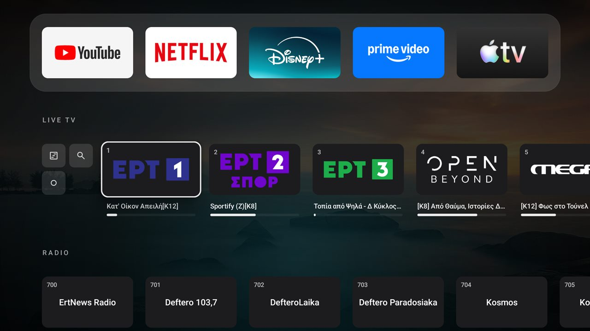

*Also in Greek: [README.el.md](README.el.md).*

## Highlights

- **In English and Greek.** The whole app, the phone remote page and the screensaver follow the TV's
  language, and *Control → Language* switches between Automatic, English and Ελληνικά.
- **Live TV where your apps are.** Channels with logos and a "what's on" progress bar sit right on
  the home screen and play on the box's hardware decoders. Tvheadend, HDHomeRun-style network
  tuners and tuner apps on the box all feed the same rows.
- **A full TV toolkit in one small app:** a programme guide, recordings, record-every-episode,
  search, reminders, pausing live TV, and radio with a live spectrum.
- **A screensaver that is actually worth looking at.** Your photos drift under a clock, with a news
  ticker along the bottom and, in turn, the weather, what's on TV right now, popular films and the
  day's headlines. [See it below.](#screensaver)
- **Apple TV polish:** a Top Shelf with what you were watching, recommendations and news, a frosted
  glass Control Center, blurred menus, and a "last watched" line under every dock app.
- **A phone remote with no app to install.** Scan a QR code, and your phone zaps, pauses, searches
  the guide, books recordings, and sends photos to the TV as wallpapers.
- **Light on purpose.** About 5.7 MB, plain Android views, nothing running in the background; made
  for a 2 GB box. [How it stays light](#how-it-stays-light).
- **Current tooling.** Gradle 9.8, Android Gradle Plugin 9.5, Media3 1.11, with unit tests and
  lint running in CI on every push.

## What it does

**Home screen**
- A dock of your favourite apps under the clock, over rotating nature wallpapers, with a glow
  coloured from the focused app. Every other app in a grid below.
- Plain Android views, nothing running in the background. The whole APK is about 5.7 MB, most of
  it wallpapers.

**Live TV**
- A **LIVE TV** row with every channel (Guide, Search, Recordings and Continue sit in a small block at its start: press Left): logo, number, what's on now and a progress bar. Pick one
  and it plays full screen on the box's **hardware decoders** (MPEG-2, H.264, HEVC, MP2, AAC, AC3).
- **Three kinds of source**, alone or together, merged into the same rows:
  - a **Tvheadend** server (everything below: guide, recordings, series, search, reminders);
  - a **network tuner** (HDHomeRun and compatibles), found on the network ("auto") or by address;
    its channels play in the same player, with pause, mini guide and stream info;
  - **tuner apps on the box itself** (e.g. a USB stick's driver app that publishes Android TV
    channels), played through Android's TV view.

  A channel Tvheadend already has stays the Tvheadend one. No source at all? The row offers setup,
  or hold OK on it to hide Live TV completely.
- **Guide**: a full-screen programme grid with channel logos, a "now" line and the selected
  programme's description. OK watches what's on or records what's coming.
- **Recordings**: what's recording, scheduled, recorded or failed. Play with seeking, cancel,
  delete. Record from the guide or from the player.
- **Radio**: stations get their own row and a calm now-playing screen with a **live spectrum**.
- **Mini guide while watching**: OK shows every channel with its logo, what's on (and how long is
  left) and what's next, over the picture.
- **Series recording**: "Record every episode" from the guide, search or player; manage series
  under Recordings.
- **Search**: find a programme by title in the whole guide, then watch, record or get a reminder.
- **Reminders**: a popup a minute before a programme starts, with Watch / Dismiss, even over other apps.
- **Continue watching**: recordings carry on where you stopped, and the last one gets a tile on
  the home row.
- **Sleep timer**: 15 min to 2 h, or the end of the programme; a one-minute warning, then standby.
- **Stream info**: codec, resolution, bitrate, plus the tuner's signal, SNR and error counters.
- **Pause live TV**, then carry on from where you paused, or jump back to live.
- **Audio and subtitle tracks**, with the language remembered from channel to channel.
- **Favourites**: hold OK on a channel to pin it; the row then shows only your favourites, in your order.
- A **red dot** on channels that are recording right now, and a warning next to LIVE TV when the
  server's recordings disk is nearly full.
- **Screensaver**: photos, clock, weather, a news ticker, what's on TV and popular films while the
  TV is idle; each part can be switched off. See [Screensaver](#screensaver).
- **Radio screen saver**: after three idle minutes the radio screen dims and drifts slowly. Opening
  the channel list there keeps the playing station centred.
- **Weather** under the clock (Open-Meteo, no account), and **Box status**: free memory and
  storage, uptime, the recordings disk; the launcher tidies its own cache once a day.
- **Last watched, under each dock app**: focus an app and its name gets what you last watched there
  ("▶ title · show · 12 min left", with a progress bar and the artwork faded in behind), or "Paused
  at 14:49", or "Last opened 20 min ago" for apps that don't say what they play. Only what was played on
  this box, kept on the box.
- **Top Shelf** (Control → Top shelf), the big area above the dock, in one of four modes:
  *Focused app* (what you last watched there, the default), *All continue watching* (a carousel
  with Resume / Remove), *Recommendations & news* (Greece's popular films from Apple's chart, with
  Apple TV and Where to watch; headlines with photos from ERT News, Kathimerini or in.gr, with a QR
  to read on your phone), or *Off*. Films and news can each be switched off.
- **Phone remote**: Control → Phone remote shows a QR code; scan it and the remote opens already
  paired (home network only). From the phone: zap, pause, back to live, volume, sleep timer, turn
  the TV off and on, the channel list, the guide (now and next on every channel, or search) with
  record / every episode / remind me, opening apps, and sending photos as wallpapers. Android
  doesn't let it press keys inside other apps.
- **Voice search**: the mic in Search uses Google TV's voice input through the remote.
- **Your dock**: hold OK on any app for Open, Add to dock / Move left / Move right / Remove from dock,
  Hide, App info and Uninstall. Up to 6 apps; your choice replaces the default list.
- **Control Center** (Control, top right), tvOS style: frosted capsules over a blurred screen.
  Sleep timer for the whole box, Wi-Fi, Bluetooth (Android TV's accessory pairing screen), Inputs,
  Settings, Top shelf, TV guide, weather details (feels like, next hours, 3 days, sunrise/sunset,
  UV, rain, air quality), phone remote, Screensaver options, Language, and round buttons for voice
  search, volume, Box status and Turn off.
- **English and Greek.** The app follows the TV's language (Settings → System → Language). To force
  one, use *Control → Language*: Automatic, English or Ελληνικά (the app restarts to apply it). The
  phone remote page follows the phone's language, and dates and weekdays follow the chosen language.
- **Frosted glass** behind every menu and dialog (a one-off blurred snapshot, so it costs nothing
  while idle), and clean line icons throughout (Material Symbols Rounded).
- **Wallpapers from your phone**: in the phone remote, *Send a photo*; it's resized on the phone and
  shown on the TV at once. Mix them with the built-in photos or show only yours.
- **Hide apps** from the grid (hold OK → Hide from All Apps).
- Optional: start the last channel when the box boots.

<table>
<tr>
<td>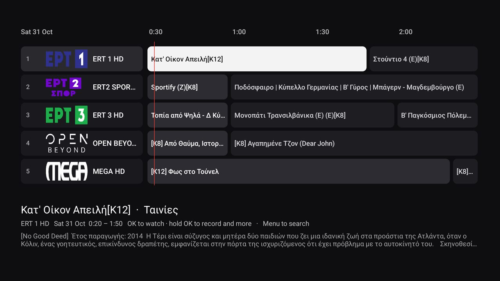</td>
<td>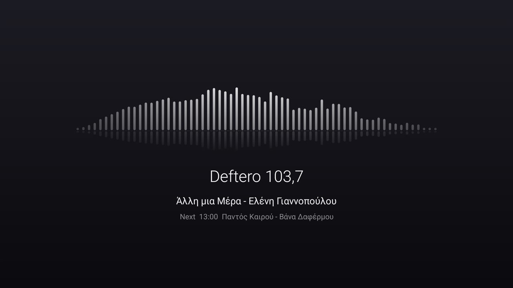</td>
</tr>
<tr>
<td>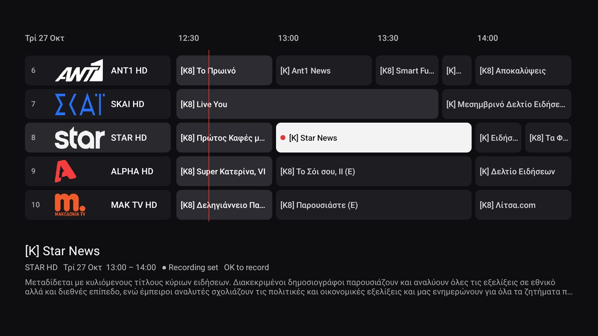</td>
<td>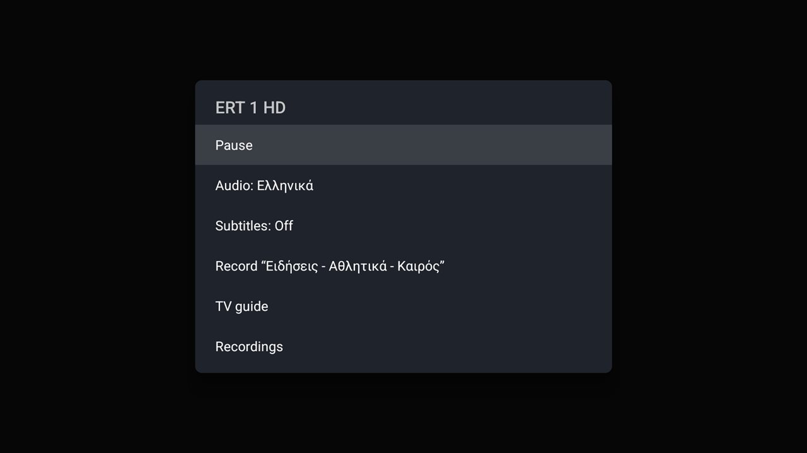</td>
</tr>
<tr>
<td>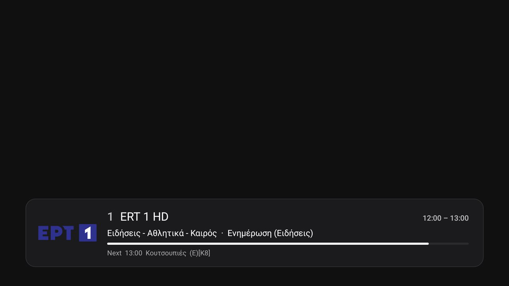</td>
<td>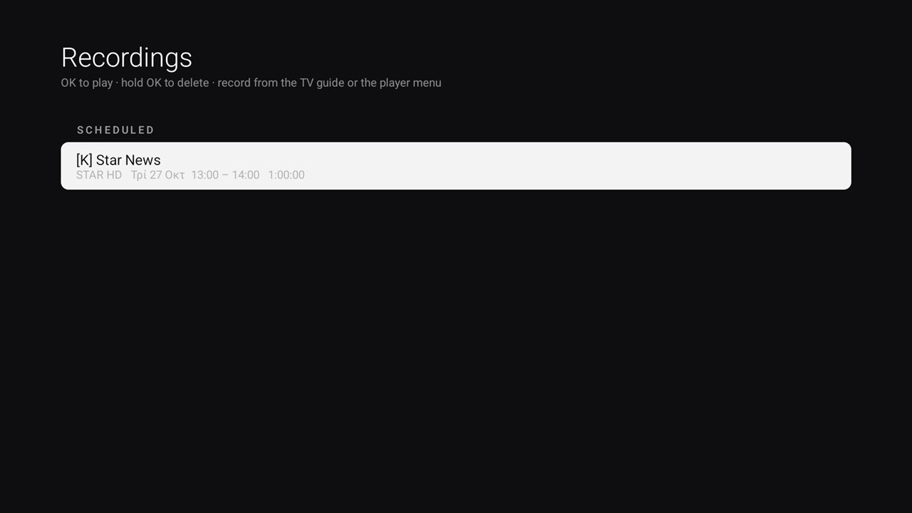</td>
</tr>
</table>

<sub>The video picture is missing from the screenshots on purpose: the box draws hardware-decoded
video on its own layer, which screenshots don't capture.</sub>

## Screensaver

When the TV sits idle (after 10 minutes, Android's usual timeout) it turns into a picture frame:

- **Photos, slowly.** The built-in wallpapers and any photos you sent from your phone crossfade with
  a gentle zoom, under a thin clock and the date. The weather sits in the corner.
- **A news ticker** scrolls the latest headlines along the bottom.
- **In between, a few slides**: the **weather** (now, feels like, three days), **what's on TV right
  now** on your favourite channels with what comes next, **popular films** with their posters, and
  **headlines** with the story's photo.
- **Nothing new to set up.** It reuses what the launcher already has: the weather city, your
  Tvheadend guide and favourites, the Top Shelf's news feed (ERT News, Kathimerini or in.gr), the
  wallpapers. Slides for things you haven't set up (no Tvheadend, no weather) simply don't appear.
- **Your choice of what shows.** *Control → Screensaver* has **Start now**, an on/off switch for
  each of Weather, On TV now, Popular films, News slides and the News ticker, and how long each
  slide stays (8, 16 or 30 seconds).

<table>
<tr>
<td>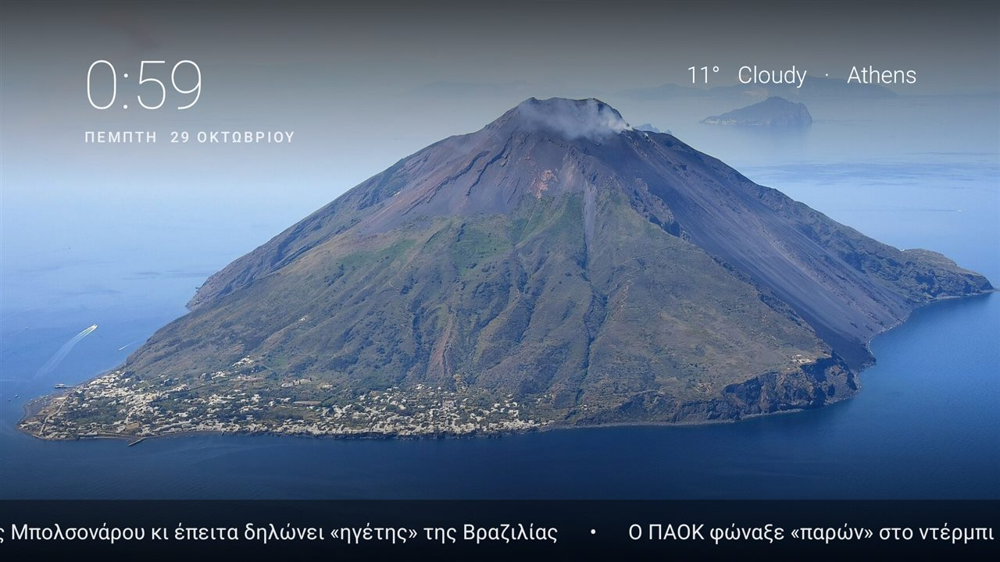</td>
<td>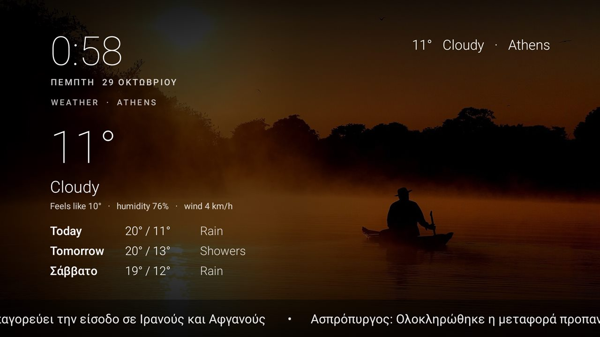</td>
</tr>
<tr>
<td>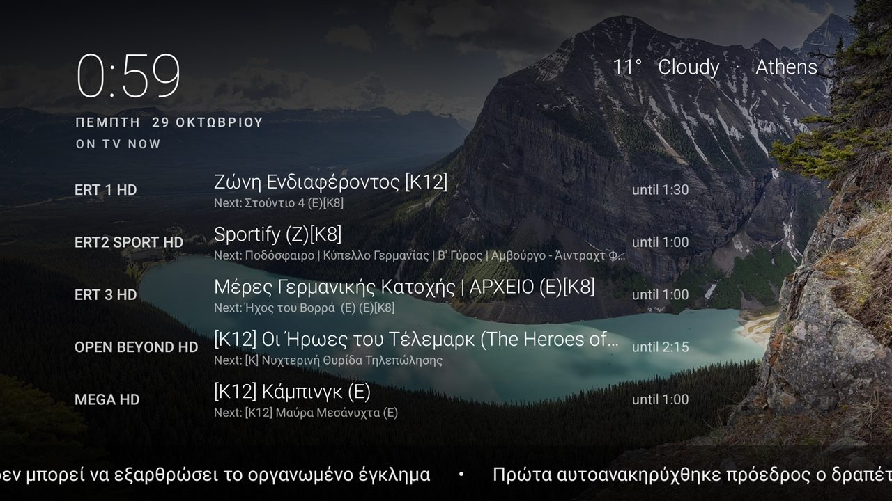</td>
<td>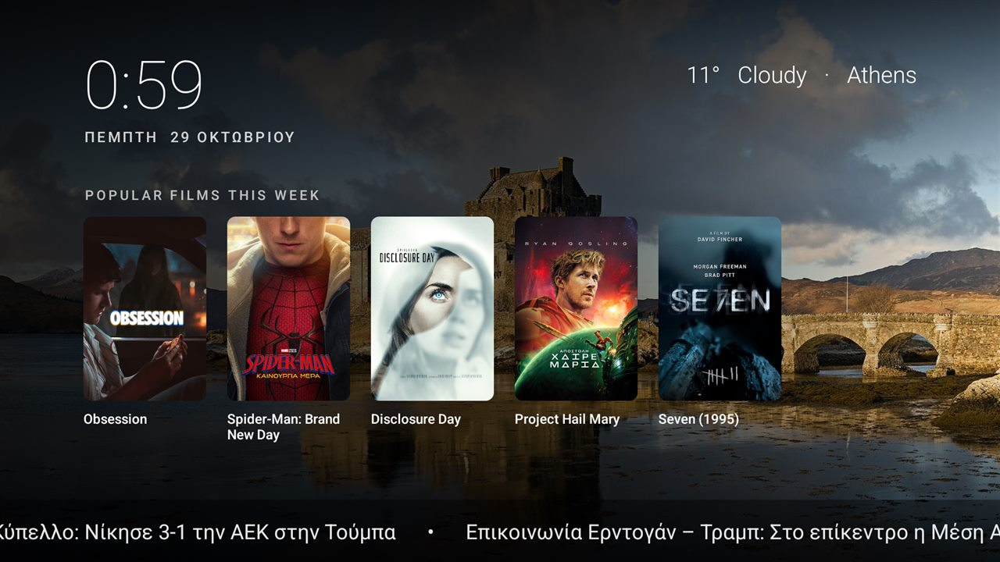</td>
</tr>
<tr>
<td colspan="2">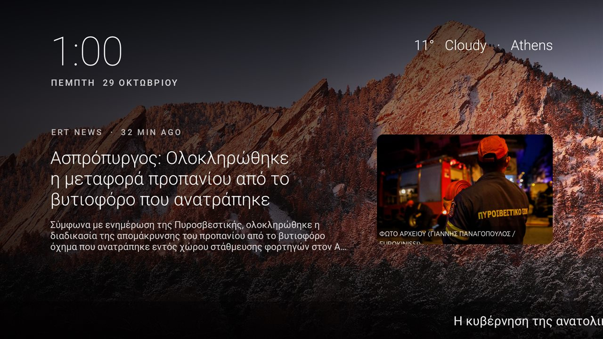</td>
</tr>
</table>

Choose it once, over ADB (Google TV's own Settings → Device preferences → Screen saver works too):

```bash
adb shell settings put secure screensaver_components io.github.ksfikas.tvhome/.Screensaver
adb shell settings put secure screensaver_enabled 1
```

To see it straight away without waiting: *Control → Screensaver → Start now*, or
`adb shell am start -a com.google.android.pano.action.SLEEP` (Google TV's own "sleep" action, which
starts the chosen screensaver). Any remote key wakes it.

## Remote control

| Where | Button | Does |
|---|---|---|
| Home | OK on a channel | Watch it |
| | Hold OK on a channel | Favourites (add, remove, reorder), Live TV setup |
| | Hold OK on an app in the grid | Hide it (bring back: *Inputs → Show hidden apps*) |
| Watching TV | Up / Down, Channel ± | Next / previous channel |
| | Left | Back to the previous channel |
| | Right, Info | Now/next banner |
| | OK | Mini guide (now and next on every channel) |
| | Hold OK, Menu | Options: pause, back to live, audio, subtitles, record, every episode, guide, recordings, sleep timer, stream info |
| | Play/Pause | Pause or resume live TV |
| | 0–9 | Tune by number |
| Guide | Arrows | Move around; more of the schedule loads as you go right |
| | OK | Watch (on now), or record / every episode / remind me (later) |
| | Hold OK | The same menu for any programme |
| | Menu | Search |
| Search | Type, then Down | Results; OK for watch / record / every episode / remind me |
| Recordings | OK, hold OK | Play (or cancel if scheduled), delete; OK on a series or reminder stops it |
| Playing a recording | Left / Right, Up / Down | Back / forward 30 s, 5 min |
| | OK | Pause |

## Install

### Before you start

- **A TV or box running Android 11 or newer.** It was built and tested on Google TV (Android 14).
  The steps below turn off Google TV's stock home screen; other Android TV models use different
  package names for theirs (see step 3).
- **A computer on the same network, with `adb`** (Android's debugging tool). Nothing to install
  beyond Google's [platform-tools](https://developer.android.com/tools/releases/platform-tools)
  download, or on Windows `winget install Google.PlatformTools`, on macOS
  `brew install android-platform-tools`.
- **The TV's IP address**: in the TV's network settings (Settings → Network & Internet → your
  connection), or in your router's list of devices. Give it a fixed address in the router so it
  doesn't change.
- **Tvheadend is optional.** Without a server you still get the home screen, Control Center,
  weather and the screensaver; Live TV, the guide and recordings need a
  [Tvheadend](https://tvheadend.org) server (or a network tuner), which you can add later.

### Steps

1. **Turn on debugging on the TV**: Settings → System → About → press OK on **Build** 7 times,
   then Developer options → **USB debugging** and **Network debugging** (which is what lets
   `adb connect` reach the TV over Wi-Fi). If your box only offers USB debugging, connect it to
   your computer with a USB cable and skip `adb connect` below.
2. **Get the APK**: download `tv-home.apk` from [Releases](../../releases), or build it:

   ```bash
   ./gradlew :launcher:assembleRelease     # JDK 17 + Android SDK (platform 36)
   ```

   (Gradle downloads itself, and Android Studio or the SDK tools fetch the matching SDK platform and
   build-tools. CI runs the unit tests and lint on every push.)

   Releases from v2.2.0 on are signed with the same key, so a new release installs straight over the
   last one with `adb install -r`. An APK you build yourself is signed with your own key: uninstall the other
   one first if you switch between the two (see the device-admin note below).

3. **Install it and make it the home screen** (Google TV):

   ```bash
   adb connect <tv-ip>:5555                                   # accept the prompt on the TV
   adb install -r tv-home.apk
   adb shell pm grant io.github.ksfikas.tvhome android.permission.ACCESS_FINE_LOCATION   # Wi-Fi name only
   adb shell pm disable-user --user 0 com.google.android.apps.tv.launcherx       # stock launcher
   adb shell pm disable-user --user 0 com.google.android.tungsten.setupwraith    # else it grabs Home
   adb shell cmd package set-home-activity --user 0 io.github.ksfikas.tvhome/.MainActivity
   ```

   Not Google TV? Skip the two `pm disable-user` lines and disable your TV's own home screen
   instead: `adb shell pm list packages` shows the package names (look for "launcher" or "home"),
   and `pm disable-user --user 0 <package>` turns one off.

   Optional extras, one line each:

   ```bash
   adb shell appops set io.github.ksfikas.tvhome SYSTEM_ALERT_WINDOW allow     # reminders pop up over other apps
   adb shell dpm set-active-admin io.github.ksfikas.tvhome/.SleepAdmin         # sleep timer can put the box to standby
   adb shell cmd notification allow_listener io.github.ksfikas.tvhome/io.github.ksfikas.tvhome.MediaWatcher   # last watched
   adb shell appops set io.github.ksfikas.tvhome GET_USAGE_STATS allow        # "last opened" for the rest
   adb shell settings put global low_power_standby_enabled 0          # phone remote works in standby (Turn on)
   adb shell pm grant io.github.ksfikas.tvhome android.permission.BLUETOOTH_CONNECT    # Control → Bluetooth (asked for on first use otherwise)
   adb shell settings put secure screensaver_components io.github.ksfikas.tvhome/.Screensaver   # the screensaver (see above)
   adb shell settings put secure screensaver_enabled 1
   ```

   The second makes the launcher a device admin with one power, turning the screen off. Android
   won't uninstall a device admin, so run `adb shell dpm remove-active-admin io.github.ksfikas.tvhome/.SleepAdmin`
   before uninstalling (updates are fine). Without it, the sleep timer just stops playback.

   Undo with `tools/windows/restore.ps1` (Windows; on macOS or Linux, run the same `adb shell pm
   enable` commands from your list by hand).

   **Did it work?** Press Home on the remote: you should see the clock over a nature wallpaper, a
   dock of apps, and (once Live TV is set up) a LIVE TV row. If you still see the stock home screen,
   the stock launcher or setup app wasn't disabled; see *Google TV hijacks the Home button* under
   Gotchas.

4. **Connect Live TV**: on the home screen, select **Set up Live TV** (or *Inputs → Live TV
   setup…*), enter `http://<server>:9981` and your Tvheadend username and password, and Save. It
   checks the login right away.

Then turn debugging off again when you're done: while it's on, anyone you've approved can run
commands on the TV.

### Upgrading from an older release

Up to v2.x the app's ID was `com.mihir.tvhome`; it is now `io.github.ksfikas.tvhome`. Android
treats that as a different app, so the new release installs *next to* the old one instead of over
it, and nothing carries over (Tvheadend login, favourites, dock, reminders). To switch:

1. Install the new APK and repeat step 3 above. That makes the new app the home screen and
   grants its permissions.
2. Check that it works, then remove the old one:

   ```bash
   adb shell dpm remove-active-admin com.mihir.tvhome/.SleepAdmin   # only if you had turned the sleep timer on
   adb uninstall com.mihir.tvhome
   ```

3. Enter your Tvheadend login again (*Set up Live TV*) and pick your favourites.

From then on, each release installs over the previous one as usual.

### Tvheadend tips

- Your Tvheadend user needs **streaming** rights, plus **video recorder** rights for recordings.
- Channel logos come from Tvheadend. If the server's picon path points somewhere without your
  channels, logos won't load; set each channel's *icon* to a URL instead. The community
  [tv-logo/tv-logos](https://github.com/tv-logo/tv-logos) set covers many countries.
- Radio stations are recognised by Tvheadend's own *Radio channels* tag.

### Other tuners

- **Network tuner**: in *Live TV setup*, enter `auto` (finds HDHomeRun-compatible tuners on the
  network) or the tuner's address. Channels come from its lineup; DRM-protected ones are skipped.
  There's no guide from the tuner itself, so recording and the guide stay Tvheadend features.
- **Tuner in the box**: install the tuner's driver app, scan channels there, then tick *Channels
  from tuner apps on this box*. Android only lets the launcher see channels marked as visible.
  These play through the driver app, so pause, track menus and stream info aren't available.
- Both are covered by unit tests. The network tuner was also checked end to end against a test
  tuner; the box tuner path has no hardware to test on yet.
- Stream info's signal figures and the disk warning come from Tvheadend's status pages, which
  need an admin user; without one they're simply left out.
- "Record every episode" is a Tvheadend autorec rule matching the title on that channel; if an
  episode is on right now, it starts recording straight away.
- On a Raspberry Pi with one tuner, fewer EPG scans help: once a day with a short timeout is
  plenty, since EIT is also collected while you watch.

## How it stays light

The box this was built on has 2 GB of RAM, so every feature had to earn its place.

- **No extra UI libraries.** Everything is drawn with plain Android views. The guide is one
  custom-drawn view, not hundreds of widgets, and the only dependency is Media3 ExoPlayer for playback.
- **Nothing in the background.** The player is released the moment you leave it. The home row
  refreshes what's on only while it's on screen.
- **Streams go untouched.** Tvheadend's `pass` profile sends the broadcast as-is, so the server
  doesn't transcode and the box decodes in hardware.
- **Pause costs nothing until you pause.** The stream runs through a small in-memory buffer.
  Only while paused does it spill to a temp file, capped at 700 MB (or the free space minus
  400 MB), and the file is deleted when you go back to live or leave.
- **The screensaver** exists only while the TV is dreaming. It decodes each photo down to screen
  size, keeps two on screen at a time, fetches news, films and weather at most every 45 minutes, and
  scrolls its ticker with one tiny update per display frame.
- **The spectrum** taps the decoded audio the player already has (no microphone permission) and
  runs only while the radio screen is visible.
- **Logos** are cached on disk, and in memory at exactly the size they're drawn.
- **Reminders** are alarms held by Android, not a background service; the sleep timer and stream
  info only tick while the player is on screen. Weather is fetched at most every 30 minutes, and
  only while home is showing.
- **Logins** use Digest auth. Live streams use Tvheadend's short-lived ticket links, so the player
  never holds your password. The login is stored only in the app's private storage on the TV.

Measured on a Xiaomi TV Box S (2nd Gen): about 98 MB for the whole launcher on the home screen
with both rows of logos, and about 86 MB while playing HD.

## Debloating

Lists are per model in [examples/](examples/); see
[examples/xiaomi-tv-box-s-gen2](examples/xiaomi-tv-box-s-gen2/debloat.txt) for the box this was
built on (telemetry, Google TV's ambient ads, optional Xiaomi extras).

```powershell
.\tools\windows\debloat.ps1 examples\xiaomi-tv-box-s-gen2\debloat.txt   # Windows (adb on PATH)
```

Undo with `tools\windows\restore.ps1` and the same list. On macOS or Linux, the list is plain
package names: run `adb shell pm disable-user --user 0 <package>` for each, one call per package.
Everything is disabled for user 0, never uninstalled, and a factory reset brings it all back.

On that box, the whole clean-up (debloat, launcher swap, 0.5× animations, cleared caches, unused
apps removed) took free memory from about **535 MB to 940 MB** after a restart, and free storage
from 1.1 GB to 1.9 GB.

### With Claude Code

This project was built in Claude Code sessions. Clone the repo, open Claude Code in it, and
describe your TV and what you want from it.

## What's here

| Path | What it is |
|---|---|
| [launcher/](launcher/) | The app: home screen, Live TV, guide, recordings, player |
| [launcher/res/values/config.xml](launcher/res/values/config.xml) | Dock apps, hidden apps, grid columns |
| [examples/](examples/) | Debloat lists per TV model |
| [tools/windows/](tools/windows/) | The debloat and restore scripts (PowerShell) |
| [.github/workflows/build.yml](.github/workflows/build.yml) | Builds the APK, runs the unit tests and lint on every push; tag `v*` to publish a release |

## Gotchas

- **Phone remote in standby.** Google TV's Low Power Standby cuts ordinary apps off the network while
  the box sleeps, so the remote can't answer or wake it. `settings put global low_power_standby_enabled 0`
  (over ADB) keeps the network up in standby, at a small cost in standby power; set it back to 1 to undo.
- **Tvheadend looks for HDHomeRuns too.** It sends the same network discovery the launcher does.
  Anything answering it should be a real tuner; a half-implemented test device made Tvheadend
  restart here.
- **Netflix doesn't exit on Back.** Netflix's TV app consumes Back on its own home screen; use
  Home (or Netflix's *Exit* item). A launcher can't change this.
- **Back from an app opened outside the launcher** (from a cast, say) returns to the previous app,
  not home. That's standard Android task behaviour; Home always works.
- **Long-press in tests.** `adb shell input keyevent --longpress` doesn't trigger long-click on
  ordinary views, which time a real held button. The player and guide read key events directly,
  so they handle both.
- **Recordings need the login per request.** Tvheadend's ticketed recordings playlist only lists
  finished recordings, so the player signs each (seeking) request with Digest auth instead.
- **Channel logos missing?** Usually the server's picon path, not the launcher: see
  *Tvheadend tips* above.
- **Bluetooth on Android TV.** The box has no standard Bluetooth settings screen, so Control →
  Bluetooth opens Android TV's *Add accessory* pairing screen instead (it needs the
  `BLUETOOTH_CONNECT` permission, which the app asks for on first use).
- **The box is about 540 dp tall**, not 1080: a 1080p TV is drawn at 2× density. When adding UI,
  size it in dp for 960 × 540, or it runs off the screen.

Google TV and ADB:
- **Google TV hijacks the Home button.** With the stock launcher disabled, the setup app
  (`com.google.android.tungsten.setupwraith`) outranks any third-party launcher. Disable it too.
- **Chained `pm` commands** (`pm disable a; pm disable b`) can silently stop after the first. The
  scripts run one per call.
- **Apps installed from the Play Store didn't appear**, because the package broadcast was missed.
  The launcher re-checks on every return.

## Tested on

- Xiaomi TV Box S (2nd Gen), Google TV, Android 14, with Tvheadend 4.3 (Greek DVB-T: ERT, Digea).

Other boxes should work if they run Android 11 or newer, but they haven't been tried. Reports are welcome.

## Credits and licence

Started as a fork of [mihirgupta0900/tv-home](https://github.com/mihirgupta0900/tv-home) (MIT);
its wallpaper set is still part of it.

Built on [AndroidX Media3](https://github.com/androidx/media) (playback, Apache 2.0),
[ZXing](https://github.com/zxing/zxing) (QR codes, Apache 2.0),
[Material Symbols](https://github.com/google/material-design-icons) (icons, Apache 2.0) and
[Open-Meteo](https://open-meteo.com) (weather data, CC BY 4.0). Wallpaper photos are from Wikimedia
Commons, each under its own licence: see [launcher/WALLPAPER-CREDITS.md](launcher/WALLPAPER-CREDITS.md).
Channel logos are not included; they come from your Tvheadend server. News headlines, photos and the
film chart are fetched live on your TV from the publishers' public feeds; nothing is stored or
redistributed here.

This project's code is MIT: © Mihir Gupta (the original project) and © Kostas Sfikas (everything
added since, including Live TV, the screensaver and the phone remote). See [LICENSE](LICENSE).
